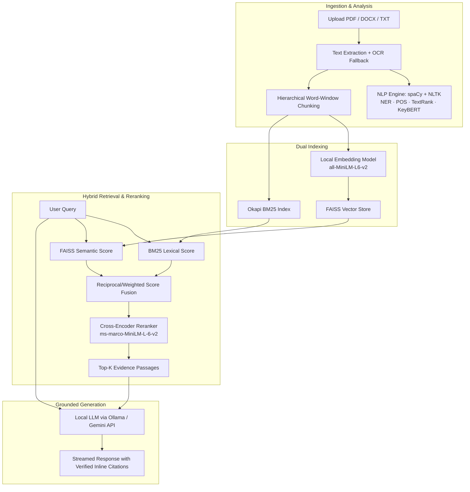

# DocuMind AI

> **Evidence-First Document Intelligence & Hybrid RAG Platform**  
> Transform complex documents into verifiable knowledge with multi-strategy retrieval, grounded citations, local LLM inference, and zero hallucinations.

---

## 🌟 Overview

DocuMind AI is a comprehensive document intelligence platform designed to eliminate LLM hallucinations through strict evidence grounding. Rather than relying on ungrounded generative answers, DocuMind combines **lexical search (BM25)**, **dense semantic search (FAISS)**, and **cross-encoder reranking** with rigorous NLP analysis (NER, POS, readability, KeyBERT/TextRank keyword extraction, knowledge graphs). 

Every generated answer is anchored to exact document pages, paragraphs, and passages with inline citations. When an answer cannot be grounded in the provided source passages, the system explicitly abstains rather than inventing facts.

---

## 🚀 Key Features

- **Grounded Ask & Conversational QA**
  - Interactive multi-turn chat over single documents or entire workspaces.
  - Coreference resolution across conversation history for contextual follow-up questions.
  - Real-time token streaming with inline `[n]` citations linked to source passages.
  - Strict evidence verification: refuses to hallucinate when text is absent.

- **Multi-Document Workspaces**
  - Group related documents into unified collections.
  - Cross-document retrieval and synthesized answering with source document badges.

- **Multi-Strategy Search Comparison**
  - Compare **Semantic (FAISS)**, **Lexical (BM25)**, and **Hybrid (Score Fusion)** retrieval side by side for any query.
  - Integrated cross-encoder reranker (`ms-marco-MiniLM-L-6-v2`) for maximal precision.

- **Deep NLP Insights**
  - **Named Entity Recognition (NER)**: 18 OntoNotes entity classes powered by spaCy (`en_core_web_lg`).
  - **POS Tagging & Linguistic Stats**: Coarse universal POS distribution, word/sentence metrics, and Flesch Reading Ease scores.
  - **Tri-Method Keyword Extraction**: Side-by-side comparison of TF-IDF, TextRank (graph centrality), and KeyBERT.

- **Hierarchical Summarization**
  - Chunk-to-section summarization combined into structured overviews at brief, standard, or detailed lengths.
  - Extractive pre-filtering as a safety buffer for dense sections.

- **Semantic Document Comparison**
  - Semantic section alignment and diff classification (unchanged, modified, added, removed) between document revisions.

- **Interactive Knowledge Graph**
  - Entity co-occurrence graph rendered with React Flow, mapping relationships across document chunks.

- **Scientific Evaluation Suite**
  - In-app evaluation harness to benchmark live pipelines against gold-standard Q&A datasets.
  - Real-time computation of **Precision@K**, **Recall@K**, **MRR**, **Token F1**, **Exact Match**, **BERTScore F1**, and **ROUGE-1/2/L**.

- **Flexible LLM Backend**
  - **Privacy-first Local Inference**: Native integration with [Ollama](https://ollama.com) (optimized for `documind-qwen3-4b` / `qwen3:4b-instruct`).
  - **Cloud Alternative**: Direct support for Google Gemini (`gemini-2.0-flash` / `gemini-3.5-flash-lite`).
  - **Fine-Tuning Pipeline**: Included scripts for QLoRA fine-tuning and prompt-level adaptation in `backend/finetune/`.

- **Multi-Format Ingestion & Robust OCR Fallback**
  - Supports PDF, DOCX, and TXT files.
  - Automated OCR fallback (`pytesseract` + `pdf2image` / `easyocr`) for scanned or image-heavy PDF pages.

- **Secure & Isolated**
  - User authentication with JWT in-memory tokens to mitigate XSS vulnerabilities.
  - Per-user document and workspace isolation.

---

## 🏗️ Architecture



---

## 💻 Tech Stack

| Domain | Technologies |
|---|---|
| **Backend** | Python 3.10+, FastAPI, SQLAlchemy, SQLite, Pydantic Settings, Uvicorn |
| **Frontend** | React 18, Vite, Tailwind CSS, Lucide Icons, React Flow |
| **Retrieval & Search** | FAISS, Rank-BM25, Sentence-Transformers (`all-MiniLM-L6-v2`, `ms-marco-MiniLM-L-6-v2`) |
| **NLP & Extraction** | spaCy (`en_core_web_lg`), NLTK, KeyBERT, scikit-learn, NetworkX, PyPDF, python-docx, PyTesseract, pdf2image |
| **LLM Inference** | Ollama (Local: `documind-qwen3-4b`, `qwen3:4b-instruct`) or Google Gemini API |
| **Authentication** | JWT (in-memory client storage for maximum XSS resilience), passlib / bcrypt |

---

## ⚙️ Quick Start

### Prerequisites
- **Python 3.10+** (tested on Python 3.12)
- **Node.js 18+** & `npm`
- **Ollama** (optional, recommended for local offline LLM inference) — [Download Ollama](https://ollama.com)
- **Gemini API Key** (optional, if using cloud LLM) — [Get API Key](https://aistudio.google.com/apikey)
- **Tesseract OCR & Poppler** (optional, needed only for scanned PDFs)

---

### Step 1: Start Ollama (for Local LLM)

If you wish to run completely locally without sending document data to cloud APIs:

```bash
# Pull the base instruct model
ollama pull qwen3:4b-instruct

# Verify it is running
curl http://127.0.0.1:11434/
```

*(Optional: see [Local Model Fine-Tuning](#-local-model-fine-tuning) to bake custom DocuMind citation prompts or train LoRA adapters).*

---

### Step 2: Backend Setup

1. **Navigate to the backend directory and set up a virtual environment:**

   ```bash
   cd backend
   python -m venv venv
   ```

   - **Windows:** `venv\Scripts\activate`
   - **Linux/macOS:** `source venv/bin/activate`

2. **Install dependencies:**

   ```bash
   pip install -r requirements.txt
   python -m spacy download en_core_web_lg
   ```

3. **Configure Environment Variables:**

   Create or edit `backend/.env`:

   ```env
   # --- LLM Settings (ollama or gemini) ---
   LLM_PROVIDER=ollama
   OLLAMA_URL=http://127.0.0.1:11434
   OLLAMA_MODEL=qwen3:4b-instruct
   OLLAMA_FALLBACK_MODEL=qwen3:4b-instruct

   # --- Optional Gemini Fallback ---
   GEMINI_API_KEY=your_gemini_api_key_here
   GEMINI_MODEL=gemini-2.0-flash

   # --- Storage & Database ---
   DATABASE_URL=sqlite:///./storage/documind.db
   UPLOAD_DIR=./storage/uploads
   VECTOR_DIR=./storage/vector_index

   # --- Security ---
   JWT_SECRET=your_super_secret_jwt_key
   ```

4. **Launch the FastAPI backend:**

   ```bash
   uvicorn app.main:app --reload --port 8000
   ```

   Verify health at `http://localhost:8000/api/health` (should return `{"status":"ok"}`).

---

### Step 3: Frontend Setup

1. **In a new terminal, navigate to the frontend directory:**

   ```bash
   cd frontend
   npm install
   ```

2. **Start the development server:**

   ```bash
   npm run dev
   ```

3. **Open the application:**
   Navigate to [http://localhost:5173](http://localhost:5173) in your browser.

---

### Step 4: Login & Demo Data

DocuMind uses authenticated, user-isolated workspaces.

1. **Default / Pre-existing Data:**
   If upgrading an existing database, existing files are tied to:
   - **Email:** `legacy@documind.local`
   - **Password:** `documind123`

2. **New Users:**
   Click **Register** on the login page to create an isolated workspace.

3. **Sample Datasets:**
   Explore sample files in `/demo-data`:
   - `research_paper_hybrid_retrieval.txt`: Ideal for testing Ask, Insights, Search comparison, and Evaluation.
   - `university_regulations_2025.txt` & `university_regulations_2026.txt`: Built for testing Semantic Compare.
   - `sample_evaluation_set.json`: Paste into the Evaluation dashboard to run empirical benchmark runs.

---

## 🐳 Docker Deployment

Run the complete stack with a single command via Docker Compose:

```bash
# In documind/
docker compose up --build
```

- **Frontend:** [http://localhost:5173](http://localhost:5173)
- **Backend:** [http://localhost:8000](http://localhost:8000)
- Pre-packaged with Tesseract OCR and Poppler utilities in the container image.
- Data persists in the `backend_storage` volume.

---

## 🧠 Local Model Fine-Tuning

DocuMind provides end-to-end tooling to adapt local language models to strict citation contracts and abstention behavior:

- **Prompt-Level Adaptation (`finetune/build_fewshot_model.py`)**: Bakes strict zero-hallucination rules and SQuAD few-shot demonstrations into an Ollama Modelfile without altering model weights.
- **QLoRA Weight Fine-Tuning (`finetune/train_lora.py`)**: Lightweight 4-bit LoRA training for Qwen3-4B on consumer GPUs (e.g., RTX 5050 8GB).
- **Packaging (`finetune/build_ollama_model.py`)**: Merges adapters and exports quantized GGUF models directly to Ollama.

Refer to [`TRAINING.md`](file:///c:/Users/DELL/Downloads/documind-ai/documind/TRAINING.md) and [`backend/finetune/README.md`](file:///c:/Users/DELL/Downloads/documind-ai/documind/backend/finetune/README.md) for step-by-step guidance.

---

## 📁 Project Structure

```
documind/
├── backend/
│   ├── app/
│   │   ├── api/            # REST & SSE streaming routers (chat, search, analysis, etc.)
│   │   ├── core/           # Config, database engine, startup migrations, security
│   │   ├── evaluation/     # Precision@K, Recall, MRR, F1, BERTScore, ROUGE engines
│   │   ├── models/         # SQLAlchemy schemas (users, documents, chunks, workspaces)
│   │   ├── nlp/            # spaCy pipeline, OCR extraction, KeyBERT, TextRank
│   │   ├── qa/             # Grounded prompt builder, Ollama & Gemini streaming clients
│   │   └── retrieval/      # BM25, FAISS indexer, hybrid ranker, cross-encoder reranker
│   ├── finetune/           # Dataset synthesis, LoRA fine-tuning, Ollama model export
│   ├── demo-data/          # Example documents and evaluation benchmarks
│   ├── storage/            # SQLite DB, uploads, and FAISS indices
│   ├── Dockerfile
│   └── requirements.txt
├── frontend/
│   ├── src/
│   │   ├── components/     # UI primitives, chat cards, citations, navbar
│   │   ├── context/        # Auth and theme context providers
│   │   ├── pages/          # Ask, Search, Insights, Compare, Workspaces, Eval, Settings
│   │   └── services/       # API clients for backend endpoints
│   ├── Dockerfile
│   ├── nginx.conf
│   └── package.json
├── docker-compose.yml
├── TRAINING.md
└── README.md
```

---

## 📜 License & Citation

DocuMind AI is developed for research and practical exploration into hybrid retrieval systems and grounded hallucination mitigation. Released under the MIT License.
