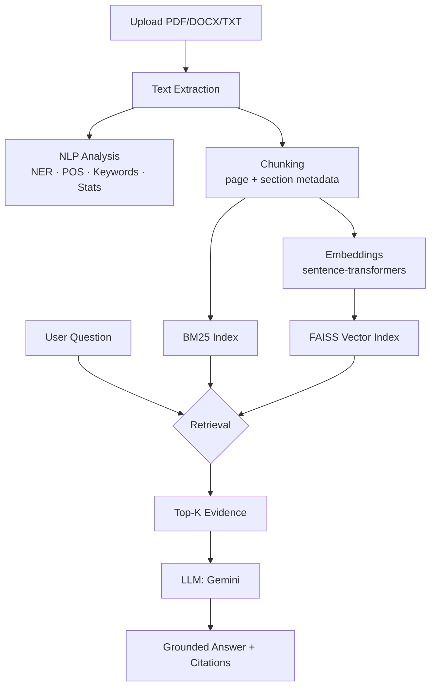

# DocuMind AI

**Turn documents into knowledge.**

DocuMind AI is an evidence-first document intelligence platform. Upload a PDF, DOCX, or
TXT file and ask it questions in plain language — every answer comes with the exact
page and passage it was drawn from, and the system explicitly says so when it can't
find an answer, rather than guessing.

## Problem statement

Large documents contain valuable information, but conventional keyword search forces
readers to manually locate and interpret relevant passages, and general-purpose chat
assistants tend to answer from outside knowledge rather than the document itself —
producing confident-sounding but ungrounded answers.

## Solution

DocuMind combines classic NLP analysis (NER, POS tagging, keyword extraction,
readability statistics) with a retrieval-augmented generation (RAG) pipeline that
supports three retrieval strategies — lexical (BM25), semantic (dense embeddings via
FAISS), and hybrid — so answers can be evaluated and traced back to source passages.

## Features

- **Ask** — conversational QA over a document, grounded in retrieved evidence, with
  explicit "not found" responses instead of hallucinated answers, and follow-up
  question context (coreference across turns).
- **Search** — semantic, keyword, and hybrid retrieval, so you can compare how each
  method surfaces different results for the same query.
- **NLP Insights** — named entity recognition, POS distribution, TF-IDF and TextRank
  keyword extraction, and readability/vocabulary statistics, all computed from the
  actual document text.
- **Summarize** — hierarchical summarization (section summaries combined into a final
  structured summary) at brief/standard/detailed lengths.
- **Compare** — semantic (not string) diff between two document versions, classifying
  each matched section as unchanged, modified, added, or removed.
- **Knowledge Graph** — an entity co-occurrence graph built from the document's own
  named entities and chunk-level co-mentions.
- **Evaluation** — a dashboard for running a labeled question set against the live
  pipeline and computing real Precision@K, Recall@K, MRR, F1, Exact Match, and ROUGE
  scores across all three retrieval methods.

## Architecture



## NLP pipeline

| Stage | Technique | Library |
|---|---|---|
| Extraction | Page-scoped text extraction, with OCR fallback for scanned PDF pages | pypdf, python-docx, pytesseract, pdf2image |
| Statistics | Sentence/word counts, Flesch reading ease | nltk |
| NER | Statistical NER (word vectors + CNN), 18 OntoNotes entity types (PERSON, ORG, MONEY, PERCENT, LAW, NORP, WORK_OF_ART, ...) | spaCy (`en_core_web_lg`) |
| POS tagging | Same spaCy pipeline as NER — Universal Dependencies tags collapsed to coarse categories, sharing one parse per document with NER | spaCy (`en_core_web_lg`) |
| Keywords | TF-IDF (sentence-level corpus), TextRank (PageRank over co-occurrence graph), and KeyBERT (embedding similarity over spaCy noun-phrase candidates) — three methods shown side by side | scikit-learn, networkx, KeyBERT, sentence-transformers |
| Chunking | Overlapping word-window chunks with heading detection | custom |
| Lexical retrieval | Okapi BM25 | rank-bm25 |
| Semantic retrieval | Sentence embeddings + FAISS flat index (cosine via inner product) | sentence-transformers, faiss |
| Hybrid retrieval | Weighted score fusion (0.6 semantic / 0.4 lexical) | custom |
| Reranking | Cross-encoder second-stage rerank over hybrid's top ~20 candidates — on by default for Ask (single-doc and cross-document) and for Search in hybrid mode | sentence-transformers (`CrossEncoder`, `cross-encoder/ms-marco-MiniLM-L-6-v2`) |
| QA generation | Grounded prompting with explicit refusal instruction; conversation history folded into the retrieval query so follow-up questions retrieve the right passages | Gemini API |
| Summarization | Hierarchical: chunk → section summaries → combined summary, with sentence-embedding extractive pre-filtering as a safety net for oversized sections | Gemini API, sentence-transformers |
| Comparison | Chunk-level semantic matching + LLM classification | sentence-transformers, Gemini API |
| Evaluation | Precision@K/Recall@K/MRR (with a reranked-vs-not comparison toggle), Exact Match, token F1, embedding cosine similarity, BERTScore F1 (token-level), ROUGE-1/2/L | scikit-learn, bert-score |

## Technology stack

- **Backend:** Python, FastAPI, SQLAlchemy, SQLite
- **Frontend:** React, Vite, Tailwind CSS, React Flow (knowledge graph)
- **Retrieval:** FAISS (local vector index), rank-bm25, sentence-transformers
  (`all-MiniLM-L6-v2`, runs locally — no embedding API costs)
- **LLM:** Google Gemini API (`gemini-2.0-flash` by default)

## Database design

SQLite via SQLAlchemy, with tables for `documents`, `document_pages`, `chunks`
(with page/section/vector-row metadata for citations), `conversations`, `messages`,
and `evaluations`. See `backend/app/models/models.py` for the full schema.

## Evaluation methodology

Retrieval quality is measured with Precision@5, Recall@5, and Mean Reciprocal Rank
against a labeled set of (question, source page) pairs. QA quality uses Exact Match,
token-level F1, and embedding-based semantic similarity against reference answers.
Summarization quality uses ROUGE-1/2/L (computed via longest-common-subsequence and
n-gram overlap — no external ROUGE library required). All metrics are computed live
against the current pipeline; nothing is precomputed or hardcoded.

## Installation

### Prerequisites
- Python 3.10+
- Node.js 18+
- **~2GB free RAM** — the NLP stack now loads spaCy's `en_core_web_lg` (~1GB resident)
  alongside the sentence-transformers embedding model. If your machine has less than
  ~2.5GB free, swap to `en_core_web_sm` in `app/nlp/spacy_model.py` (smaller/faster,
  noticeably less accurate) rather than risk it OOMing under load.
- A free [Gemini API key](https://aistudio.google.com/apikey)
- (Optional, for scanned/image-only PDFs) [Tesseract OCR](https://github.com/tesseract-ocr/tesseract)
  and [Poppler](https://poppler.freedesktop.org/) installed as system binaries — see
  [OCR fallback for scanned PDFs](#ocr-fallback-for-scanned-pdfs) below. Without them,
  ordinary text-based PDFs, DOCX, and TXT files work exactly as before.

### Backend

```bash
cd backend
python3 -m venv venv
source venv/bin/activate        # Windows: venv\Scripts\activate
pip install -r requirements.txt
python -m spacy download en_core_web_lg   # ~560MB, one-time — powers NER/POS

cp .env.example .env
# edit .env and paste your GEMINI_API_KEY

uvicorn app.main:app --reload --port 8000
```

The first request that triggers embeddings will download the local embedding model
(~90MB, one-time) and NLTK will download its corpora automatically. The first NER/POS
request loads spaCy's model into memory (~1GB resident, ~8s one-time cold start, then
fast); the first keyword-extraction or evaluation request likewise loads the shared
sentence-transformers model used by KeyBERT and BERTScore.

### Frontend

```bash
cd frontend
npm install
npm run dev
```

Open **http://localhost:5173**. The dev server proxies `/api` to the backend on port
8000 (see `vite.config.js`).

### Environment variables

See `backend/.env.example`:

```
GEMINI_API_KEY=        # required — get one at https://aistudio.google.com/apikey
GEMINI_MODEL=gemini-2.0-flash
DATABASE_URL=sqlite:///./storage/documind.db
UPLOAD_DIR=./storage/uploads
VECTOR_DIR=./storage/vector_index
EMBEDDING_MODEL=sentence-transformers/all-MiniLM-L6-v2
JWT_SECRET=            # signs auth tokens — set a real random value outside local dev
```

### Auth and per-user data

DocuMind requires an account: register or log in from the app's login screen before
uploading or asking anything. Documents and workspaces are scoped to the logged-in
user — you only ever see your own.

The session token is kept in memory only (never `localStorage`), so refreshing the
page or closing the tab logs you out — this is deliberate, to avoid a stored token
being readable by an XSS payload.

**If you're upgrading from a version of DocuMind without auth:** any documents or
workspaces already in your local database are automatically attached to a one-time
"legacy" account on first startup, rather than becoming orphaned:

```
email:    legacy@documind.local
password: documind123
```

Log in with those credentials to see your pre-existing data, then register your own
account and, if you want, re-upload documents under it — there's no UI to transfer
ownership between accounts yet.

### OCR fallback for scanned PDFs

PDF pages that extract as empty or near-empty text (i.e. scanned/image-only pages) are
automatically re-processed with OCR (`pytesseract` + `pdf2image`) instead of being
treated as unreadable. This requires two system-level binaries — **not** Python
packages, so `pip install -r requirements.txt` alone won't provide them:

- **Tesseract OCR** — `sudo apt install tesseract-ocr` (Debian/Ubuntu),
  `brew install tesseract` (macOS), or the [Windows installer](https://github.com/UB-Mannheim/tesseract/wiki).
- **Poppler** (needed by `pdf2image` to rasterize PDF pages) — `sudo apt install poppler-utils`,
  `brew install poppler`, or the [Windows binaries](https://github.com/oschwartz10612/poppler-windows/releases/)
  (add the `bin/` folder to your `PATH`).

If neither is installed, DocuMind still works normally for text-based PDFs, DOCX, and
TXT — only fully scanned PDFs are affected, and they fail with a clear message
distinguishing "OCR unavailable on this server" from "this document is genuinely
empty," rather than a generic extraction error.

### Running with Docker Compose

One-command setup for both services (requires Docker + Docker Compose):

```bash
cd backend
cp .env.example .env
# edit .env and paste your GEMINI_API_KEY — docker-compose reads this file directly

cd ..
docker compose up --build
```

- Frontend: **http://localhost:5173** (nginx, serving the production build and
  proxying `/api` to the backend container)
- Backend: **http://localhost:8000** (also reachable directly for API testing)
- SQLite database, uploaded files, and the FAISS index persist in the
  `backend_storage` named volume across restarts (`docker compose down -v` to wipe it)
- The backend image installs `tesseract-ocr` and `poppler-utils`, so OCR fallback for
  scanned PDFs works out of the box in Docker even without those installed on your host

### Try it with demo data

Sample documents are in `/demo-data`:
- `research_paper_hybrid_retrieval.txt` — for Ask, Search, Insights, Summarize, Evaluation
- `university_regulations_2025.txt` + `university_regulations_2026.txt` — for Compare
- `sample_evaluation_set.json` — paste into the Evaluation page against the research paper

## Running locally — quick check

1. Start the backend (`uvicorn app.main:app --reload --port 8000`) and confirm
   `http://localhost:8000/api/health` returns `{"status": "ok"}`.
2. Start the frontend (`npm run dev`) and open `http://localhost:5173`.
3. Upload `research_paper_hybrid_retrieval.txt` from `/demo-data` and watch the real
   processing pipeline (extracting → analyzing → embedding → indexing → ready).
4. Go to **Ask** and try: *"What methodology does the paper use?"* — then a follow-up
   like *"What weighting did it use?"* to see conversation memory in action.
5. Go to **Search**, try *"students who are not eligible for the final exam"* against
   the regulations documents once uploaded — compare Semantic vs Keyword vs Hybrid.
6. Upload both regulation documents and use **Compare**.

## Future improvements / left for continuation

See `CONTINUE_WITH_CLAUDE_CODE.md` for a ready-to-run prompt covering:
- Multi-document workspaces and cross-document QA
- Reranking stage in the retrieval pipeline
- OCR fallback for scanned PDFs
- Streaming LLM responses
- Auth and per-user document isolation
- Dark/light theme toggle (currently dark-only)
- Docker Compose packaging

## Academic/research motivation

This project investigates: *How does semantic and hybrid retrieval affect the quality
of document question answering compared with traditional lexical retrieval?* The
Evaluation dashboard is built specifically to let you answer this empirically against
your own documents and question sets, comparing BM25, semantic, and hybrid retrieval
side by side on the same metrics.
